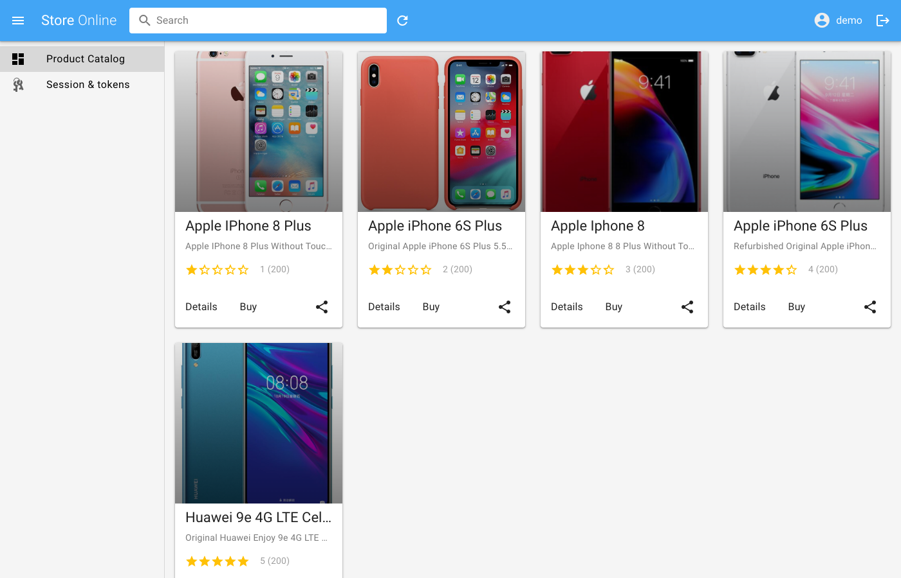
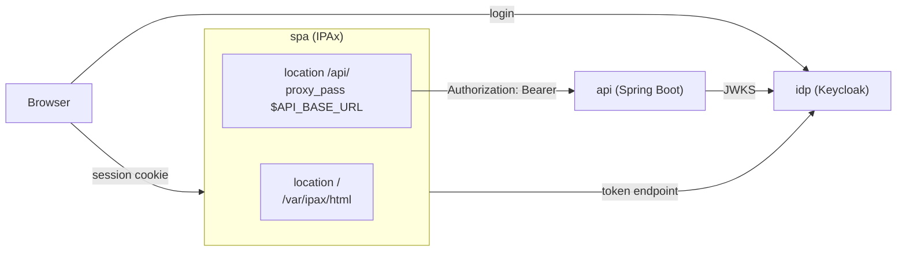
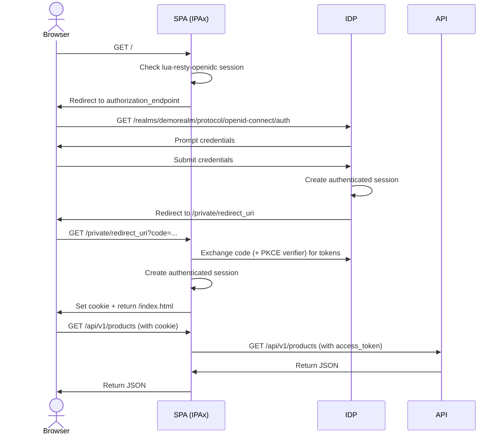

# spa-demoapp-vue

Demo Single Page Application built with [Vue 3](https://vuejs.org/) and [Vuetify](https://vuetifyjs.com/), protected by [IPAx](https://github.com/identicum/ipax) (OpenResty + [lua-resty-openidc](https://github.com/zmartzone/lua-resty-openidc)).

The SPA never handles tokens. IPAx authenticates the user against the IdP (OIDC Authorization Code + PKCE), keeps the tokens in a server-side session, and adds the access token as a `Bearer` header when the SPA calls the API (`/api/v1/products`). This is the *Backend for Frontend* (BFF) pattern.



## Architecture



| Service | Image | Role |
|---------|-------|------|
| `idp` | `ghcr.io/identicum/keycloak` | OpenID Provider. Imports the `demorealm` realm from [keycloak/realm.json](./keycloak/realm.json) |
| `spa` | `ghcr.io/identicum/spa-demoapp-vue` (this repo) | IPAx serving the Vue build. The virtual host is in [nginx/spa.conf](./nginx/spa.conf) |
| `api` | `ghcr.io/identicum/oauth-demoapi-spring` | Resource server. Validates the JWT and requires the `api.identicum.com/products:read` scope |

### Login sequence



## Test environment

Requirements: Docker with Compose v2.

1. Add this line to your local hosts file (`/etc/hosts`), so the browser and the containers use the same URLs:
   ```
   127.0.0.1  spa  idp  api
   ```
2. Start the environment:
   ```sh
   docker compose up -d
   ```
   To build the SPA image from your working copy instead of pulling it, run `docker compose up -d --build`.
3. Open <http://spa/> and log in with `demo` / `demo`.

| URL | Description |
|-----|-------------|
| <http://spa/> | The SPA |
| <http://spa/private/info> | IPAx info page: ID token, access token, userinfo and HTTP headers |
| <http://spa/private/logout> | Logout (IdP session included) |
| <http://idp:8080/admin/> | Keycloak admin console (`admin` / `admin`) |

All ports are bound to `127.0.0.1` only.

### Keycloak realm

[keycloak/realm.json](./keycloak/realm.json) is imported on startup (`start-dev --import-realm`). If the realm already exists, it is not overwritten. It contains:

- Client scopes `api.identicum.com/products:read` and `api.identicum.com/products:write`. Both add `api_client_id` to the access token audience.
- The Keycloak built-in scopes `basic`, `profile`, `email`, `roles`, `web-origins` and `acr`. A realm import that defines `clientScopes` does not create them.
- Client `spa_client_id` (confidential, Authorization Code). It is used by IPAx.
- Client `api_client_id` (confidential, service account). It represents the API.
- User `demo` / `demo`.

`start-dev` stores data in the container, so `docker compose down` resets the realm to the contents of `realm.json`.

## SPA development

The app is in [spa/](./spa/). It uses Vite and needs Node.js 22.12 or later.

```sh
cd spa
npm install
npm run dev      # dev server with hot reload
npm run lint     # ESLint
npm run build    # production build in spa/dist
```

The dev server only serves the UI. `/api` and `/userinfo` are provided by IPAx, so to test the full flow, build the image with `docker compose up -d --build`.

## Container image

The [Dockerfile](./Dockerfile) builds the SPA with Node.js and copies `dist/` to `/var/ipax/html` of the IPAx image.

The [docker-build workflow](./.github/workflows/docker-build.yml) uses the shared [Identicum/github-actions](https://github.com/Identicum/github-actions) `docker-build-autotag` workflow. On every push to `main` that changes `spa/` or the `Dockerfile`, it publishes `ghcr.io/identicum/spa-demoapp-vue` for `linux/amd64` and `linux/arm64`, tagged `latest` and with the build date (`YYYYMMDD`). It can also be run manually.
